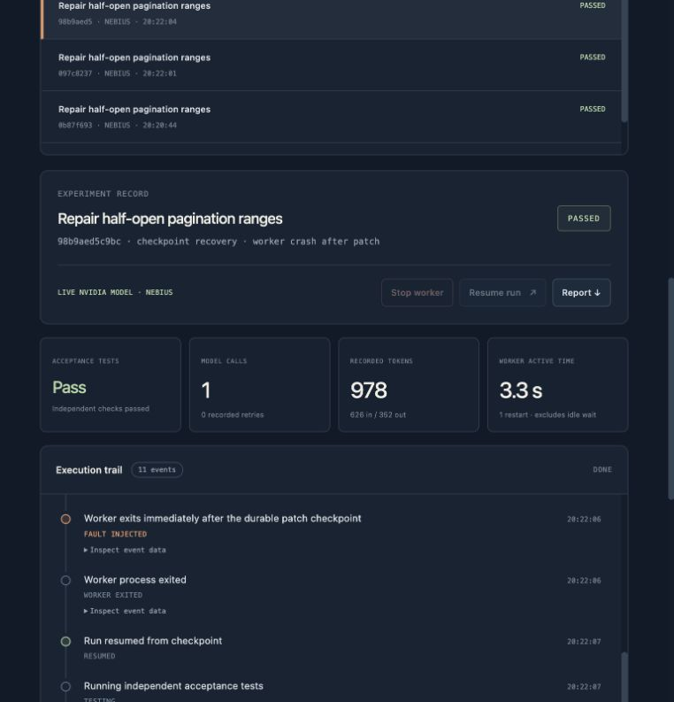

# Agent CrashLab

[](https://github.com/IME777/agent-crashlab/actions/workflows/verify.yml)

[MIT license](LICENSE) · [Judge guide](docs/JUDGE-GUIDE.md) · [Architecture](docs/ARCHITECTURE.md) · [Verification](docs/VERIFICATION.md) · [中文配置](docs/NEBIUS-SETUP.zh-CN.md)

[Publication status](docs/PUBLISHING.md) · [Full-runtime deployment](deploy/README.md) · [Devpost copy](docs/DEVPOST.md) · [2:45 demo script](docs/DEMO-SCRIPT.md)

Canonical source: <https://github.com/IME777/agent-crashlab>. The publication candidate is tagged `v0.1.0-rc.1`; the final hackathon submission freeze remains a separate step.

**Break a coding agent's worker. Check whether it still delivers the right patch.**

[Explore recorded live evidence](https://agent-crashlab-evidence-jm.emiandtuzi.chatgpt.site) — public, no login or API key required. The website replays completed experiments and offers the runnable source package; it does not start a new hosted worker or make new inference calls.

Agent CrashLab gives developers a reproducible failure check before releasing a
coding agent. NVIDIA Nemotron on Nebius repairs a small Python module; CrashLab
persists the patch, interrupts a real worker process, resumes the run, and tests
the delivered code against independent acceptance tests.

The result is an inspectable experiment: patch, fault boundary, recovery events,
test verdict, and recorded model usage. The implementation uses the Python
standard library, SQLite, subprocess workers, and Docker. No frontend build or
third-party Python runtime packages are required.



## Verified result

The final live check used `nvidia/nemotron-3-super-120b-a12b` through Nebius Token
Factory on the `page-slices` repair task.

| Case | Real model requests | Reported input / output tokens | Independent Docker tests |
|---|---:|---:|---|
| No fault | 1 | 626 / 283 | 4/4 passed |
| Worker exit 86, then resume | 1 | 626 / 352 | 4/4 passed |

In the recovery case, the saved candidate hash, request count and known token
totals stayed unchanged across the resume. No fixture generations or unknown
usage requests were recorded in these final cases.

This is evidence for **one small task and a specified crash boundary**, not a
general coding benchmark or production reliability guarantee. An
[initial live attempt](examples/live-check-initial.json) is retained: its first
candidate violated the pure-function execution contract, so another repair was
needed and the stricter no-additional-inference recovery check failed. The
generic execution constraint was clarified before rerunning the same two cases.

Evidence: [final live report](examples/live-check.json),
[18-case offline smoke matrix](examples/offline-check.json),
[Docker execution and kill cleanup](examples/docker-check.json),
[HTTP checks](examples/http-check.json), and the [verification record](docs/VERIFICATION.md).
See the [judge guide](docs/JUDGE-GUIDE.md) for the current access mode and testing instructions.

## Run locally in one minute

Requires Python **3.11+ on macOS or Linux**. From the source checkout:

```bash
python3 -m crashlab serve
```

Open <http://127.0.0.1:8765>. **Offline fixture** uses a known trusted repair and
makes no model API calls. It exercises the workflow and actual process recovery;
it does not measure model quality. Choose a task, keep **Worker crash after patch**,
run it, then select **Resume run** when the worker is interrupted.

```bash
# Offline comparison of resume versus restart.
python3 -m crashlab --data /tmp/crashlab-demo demo

# Offline checks with a machine-readable report and a failing exit code on failure.
python3 -m crashlab --data /tmp/crashlab-check check \
  --output /tmp/crashlab-check/report.json

python3 -m unittest discover -s tests -v
```

A data directory has one control-plane owner. Use a separate `--data` directory
for CLI experiments while the dashboard is running. Local SQLite databases,
workspaces and `.env` files are excluded from source distribution.

## Run a real NVIDIA model

1. Copy `.env.example` to `.env` and set a **Token Factory** `NEBIUS_API_KEY` plus
   an account-available NVIDIA `NEBIUS_MODEL` ID. Keep the key local.
2. Start Docker and prepare the official test image: `docker pull python:3.12-slim`.
3. Check readiness and account-visible model IDs:

```bash
python3 -m crashlab doctor
python3 -m crashlab models
```

4. Run the bounded live verification. **This makes metered Nebius requests.**

```bash
python3 -m scripts.verify_live --task page-slices \
  --data .crashlab-live --output examples/live-check.json
```

It attempts a no-fault repair, then a worker crash and one resume. Each case
allows at most two repair candidates and three transport attempts per candidate.
The model ID is pinned per run. The provider forces a `submit_patch` function
call; acceptance failures can feed one further repair. Credentials stay on the
server. There is no fallback to fixture answers or host execution of model code.

To inspect locally stored live runs, stop another server on port 8765 and run:

```bash
python3 -m crashlab --data .crashlab-live serve
```

A fresh checkout includes exported evidence, not the original local runtime
database. [Configuration walkthrough](docs/NEBIUS-SETUP.zh-CN.md).

## What the fault check proves

- **Durable patch boundary:** the patch and known usage commit to SQLite before
  the worker exits with code 86. Recovery reconstructs the workspace from it.
- **Explicit policies:** `resume` keeps committed work; the simple `restart`
  baseline clears the checkpoint while retaining aggregate counters and events.
- **Independent acceptance:** the agent can replace only the candidate source,
  not the acceptance tests. Model-generated code runs only in restricted Docker.
- **Honest accounting:** `model_calls` counts remote attempts; `fixture_calls`
  counts offline generations. Missing billed usage remains explicitly unknown.
  Worker active time excludes the user's wait before resuming. No dollar costs
  are inferred from token totals.

The optional `model_429_once` profile is a **synthetic pre-request fault**, not a
recorded Nebius outage. The live verification above covers crash/resume; the
18-configuration resume/restart matrix is an offline smoke check.

## Execution and deployment limits

The default API binds to loopback. The local control plane is intended for one
operator; public access requires a deployment configuration and controlled
model spending. See the [judge guide](docs/JUDGE-GUIDE.md) for what is actually hosted.

Candidates are limited to pure-function repairs and checked before Docker
execution. Containers use no network, read-only mounts, a nonroot user and
resource/time/output limits. A run-scoped label and container-side deadline
support cleanup after worker loss. This is **not a hardened hostile multi-tenant
sandbox**. A crash before an inference response is durably saved may repeat that
request and incur additional charges; no universal exactly-once claim is made.

## Reproduce and package

Optional integration checks require a prepared Docker image or a running local server:

```bash
python3 -m scripts.verify_docker
python3 -m scripts.verify_http

# Sanitized source archive plus a file-checksum manifest; no credentials required.
python3 -m scripts.package_release
```

The package helper accepts only explicit source roots, rejects symlinks, excludes
runtime/credential/cache/archive paths, and checks configured environment secret
values without printing them. The owner can add `--scan-local-env` to also check
the locally configured Nebius key before publication. It does not include `.env`.

GitHub Actions runs the offline suite and smoke matrix without model credentials.
See [contributing](CONTRIBUTING.md), [security boundaries](SECURITY.md),
[MVP scope](docs/MVP.zh-CN.md), and [submission materials](docs/SUBMISSION.md).

References: [Nebius function calling](https://docs.tokenfactory.nebius.com/ai-models-inference/function-calling),
[hackathon rules](https://nebiusglobalaihackathon.devpost.com/rules).
