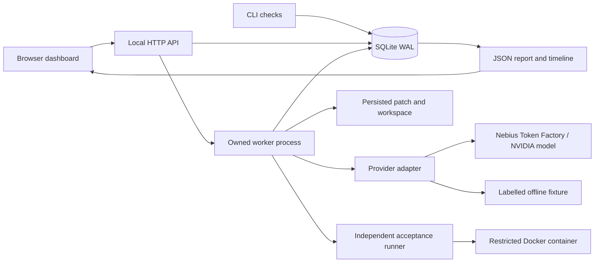

# Agent CrashLab architecture

Planning baseline: 2026-10-27. Verified locally: 53 offline tests, an 18/18 fixture smoke matrix, 14 HTTP checks, browser recovery and persistence, and real Docker execution/kill cleanup. Real Nebius Nemotron repair and crash/recovery also passed for `page-slices`: one request per final case, with unchanged patch and known token counts on recovery. The initial attempt requiring another repair is retained. See [VERIFICATION.md](VERIFICATION.md) for evidence and [MVP.zh-CN.md](MVP.zh-CN.md) for scope.

## Deployment shape

One local application serves a static dashboard and a small JSON API. It starts a separate process for each selected run. The initial delivery uses the Python standard library, an explicit bounded state machine, and SQLite in WAL mode. This keeps installation small and makes crash boundaries inspectable. Adding a general workflow framework is deferred; persistence itself is not presented as a novel invention.



The hosted demonstration will require an operator-managed host capable of running Docker, a persistent data directory, and process supervision. Hosting remains a delivery task until a judge-accessible instance has been tested. The local server is not a public multi-tenant service.

The [public recorded-evidence viewer](https://agent-crashlab-evidence-jm.emiandtuzi.chatgpt.site) is deployed separately as static assets. It makes no inference calls. The [full-runtime VM recipe](../deploy/README.md) is prepared but not remotely installed: native systemd service, host Docker, authenticated Caddy HTTPS, explicit origin allowlist, 30 cumulative live runs by default and six remote requests per run across recovery. These controls are covered by local tests; remote TLS/login/new-worker acceptance remains pending.

## Responsibilities

| Component | Responsibility | Boundary |
| --- | --- | --- |
| Task catalogue | Task instructions, buggy source, independent acceptance harness | Public metadata and model prompts omit known solutions |
| Provider adapter | Fixture generation or a real Nebius request using `urllib` | The API key is server-side only; model ID is pinned per run |
| Worker | Bounded generation, patch persistence, test execution and status transitions | No arbitrary repository paths or arbitrary shell tool |
| Store | Run state, checkpoints, aggregate metrics and ordered events | Transactions protect updates; a consistent snapshot reads state and events together; WAL is not a distributed queue |
| Process manager | Start, observe, stop and resume this application's children | Never signal a process based only on an untrusted request PID |
| Acceptance runner | Execute a candidate against tests the agent cannot edit | Real model output uses Docker only |
| Report | Describe this run and the evidence behind its outcome | Never translate fixture output into live-model results |

## Model interaction

The real provider uses the Nebius API at `https://api.tokenfactory.nebius.com/v1/`. `NEBIUS_MODEL` initializes a run's model ID; once set, that ID is pinned across requests and recovery even if the environment changes. A request forces the `submit_patch` function with a source string argument. The backend validates response shapes, tool output, and nonnegative integer token usage. Malformed tool output preserves known usage when the provider supplied it. A bounded retry/repair loop may supply test feedback; loop counts and limits are recorded.

The API supports tool invocation instructions; the model does not execute code itself. See [Nebius function calling](https://docs.tokenfactory.nebius.com/ai-models-inference/function-calling).

The execution contract is also explicit in the task prompt: all method/attribute access is outside this pure-function benchmark domain. The first real run submitted `list.append`, which the AST guard rejected; the agent then repaired it. Strengthening that generic constraint in the prompt allowed the final two-case check to retain the original candidate on recovery. No reference answer or hidden acceptance tests were supplied to the model, and the guard was not weakened.

Credentials are read from the process environment or a local ignored `.env` file. They are never sent to the browser, placed in reports, supplied to the test container, or logged as request headers. Missing credentials or model configuration produces an actionable blocked state. Availability and compatibility must be checked with a real account; a configured string is not proof that a model can be called.

## Run and checkpoint contract

Run statuses: `queued`, `running`, `crashed`, `passed`, `failed`, `blocked`. The persisted phases are `prepare`, `model`, `validate`, `done`. Patch and reported usage are committed together before phase `validate`; accepted test output sets `passed`/`done`. An unavailable execution environment can leave a run `blocked` at `validate`, allowing explicit recovery. The status and phase describe different dimensions.

A run records:

- Immutable task, provider, policy and fault selection; model/configuration identity.
- Creation/update timestamps, status and phase.
- A checkpoint with saved source/diff and, when available, acceptance output.
- An append-only event history for start, generation, injected fault, retry, recovery and completion.
- Aggregate metrics that survive both recovery strategies.
- SHA-256 identities for the runtime source and task definition, plus the returned model identity in the patch checkpoint.

`resume` reuses completed, committed work. `restart` clears the execution checkpoint and restarts the task while preserving the experiment's history, cumulative metrics, and already-triggered fault flag. Both increment `restarts` when recovering a crashed or blocked run. This is an explicitly labelled simple baseline, not a benchmark against all production frameworks. A control-plane lease prevents simultaneous CLI/server supervisors on the same data directory; the initial manager allows one active worker.

## Fault boundaries

| Fault | Injection | Required evidence |
| --- | --- | --- |
| `worker_crash_after_patch` | After the patch/checkpoint is durable, the worker exits with code 86 | A real child process exited; saved patch remains; resume continues to verification |
| `model_429_once` | An explicit synthetic 429 at the provider boundary | A labelled injection event; bounded retry; synthetic rejection is not counted as a successful remote inference |
| Manual crash | Process manager terminates its own active worker | Child ownership checked; final status reflects interruption |

A crash between a remote completion and local persistence can cause the inference to be repeated. A transaction cannot make a third-party model call exactly once. The first slice makes no guarantee about arbitrary external side effects. Docker containers carry a validated run-scoped label; the supervisor removes containers owned by that run after an abnormal worker exit. A trusted container-side deadline also survives loss of the host worker. A real manual-kill integration check observed the container before interruption and found no remaining run containers afterward; see [Docker evidence](../examples/docker-check.json).

## Test execution boundary

`fixture` runner mode permits only exact known starter or solution text from the built-in task catalogue. It supports offline tests of the plumbing; it is not a sandbox for arbitrary generated Python.

`docker` runner mode first validates the candidate against a restricted pure-function AST policy. It writes a disposable candidate and an independently supplied acceptance harness, then runs the preinstalled `python:3.12-slim` image with networking disabled, a read-only root filesystem, no extra capabilities, a non-root user, and process/memory/CPU/time limits. A trusted container entrypoint enforces the test deadline independently; the host bounds captured output and performs scoped cleanup. It does not automatically pull an image. The current local image was explicitly prepared and tested on Docker 29.4.2. No Docker socket, home directory, or credential file is mounted inside the test container.

These restrictions are useful containment for a single-operator demo, not a claim of a hardened hostile multi-tenant execution platform.

## Metrics and accounting

| Field | Definition |
| --- | --- |
| `model_calls` | Attempted remote inference requests; fixture runs record zero. Provider retries must be included and synthetic pre-request failures identified separately. |
| `fixture_calls` | Trusted offline patch generations. This is independent of remote requests and does not imply NVIDIA usage. |
| `input_tokens`, `output_tokens` | Sum of usage explicitly returned by completed remote responses and durably saved. Unknown usage is not zero. |
| `unknown_usage_requests` | Requests whose token usage was not available/persisted. A pending inference is finalized as unknown immediately when its worker exits or a restarted supervisor detects the interrupted run; the pending flag is cleared to prevent double-counting. |
| `retries` | Retry attempts attributable to transient provider errors, separate from a new repair round. |
| `restarts` | Number of explicit post-interruption run restarts/resumes, with policy in the event history. |
| `elapsed_ms` | Accumulated worker active time recorded by the supervisor on worker exit; excludes user waiting time between crash and recovery. It is not end-to-end wall-clock completion latency. |
| Acceptance result | Independent tests, return code, bounded output, duration and runner mode. |

Persist the counting boundary before making a remote request where possible. If the process exits before usage can be saved, record the uncertainty; do not reconstruct billed tokens from a guessed completion. Reports should avoid dollar amounts until a versioned price source and known/unknown usage handling are implemented. API integration does not measure GPU throughput or model-serving performance.

## HTTP surface

| Method | Route | Purpose |
| --- | --- | --- |
| GET | `/api/config` | Read safe capability flags; no key value |
| GET | `/api/tasks` | List task metadata without solutions |
| GET / POST | `/api/runs` | List or create an explicitly configured run |
| GET | `/api/runs/{id}` | Read state, metrics, checkpoint and events |
| POST | `/api/runs/{id}/start` | Start a queued run |
| POST | `/api/runs/{id}/resume` | Resume/restart a crashed run using its policy |
| POST | `/api/runs/{id}/crash` | Interrupt the owned active worker |
| GET | `/api/runs/{id}/report` | Download the run's JSON report |

Creation and execution are separate operations. Browser polling observes state and must not initiate paid model calls. Unknown routes/IDs, invalid policies and unsupported transitions must fail explicitly. The server should bind to loopback by default; public hosting requires deliberate access and spending controls.

## CLI and outcomes

Run from the repository root with Python 3.11+ on macOS/Linux. `--data` is a global argument and belongs before the subcommand. The server and CLI must use separate data directories when running simultaneously.

```bash
python3 -m crashlab serve --port 8765
python3 -m crashlab doctor
python3 -m crashlab tasks
python3 -m crashlab --data /tmp/crashlab-demo demo --task capped-backoff
python3 -m crashlab --data /tmp/crashlab-check check --provider fixture --output /tmp/crashlab-check/report.json
python3 -m crashlab run capped-backoff --provider nebius --policy resume --fault worker_crash_after_patch --auto-resume
python3 -m crashlab report RUN_ID
```

`doctor` makes readiness checks without inference; it cannot certify that a configured model/account accepts a request. `demo` always uses fixtures and compares the two policies. `check` runs three tasks × two policies × three fault selections, for an expected 18 runs; it stops early on a blocked run. This is an automated smoke matrix with one execution per configuration, not a statistical benchmark. `check --provider nebius` initiates paid remote inference and requires live prerequisites.

Single-run exit codes are 0 (`passed`), 1 (other failures), 2 (`blocked` or invalid invocation), and 3 (`crashed` without automatic recovery). The matrix returns 0 only when every expected run passes independent acceptance, verifies its selected fault profile, and has valid provider evidence; it returns 1 otherwise. `report` prints an existing run without executing it. Unknown IDs produce an error. The report stores runtime/task hashes for reproduction.

## Deferred architecture

Broader fault matrices and statistical repetition, a second agent adapter, worker queues and distributed leases, cancellation semantics, tenant isolation, broader tool idempotency, OpenTelemetry and self-hosted GPU inference follow after this bounded smoke matrix. A second workflow is needed before claiming a broadly reusable platform abstraction.
