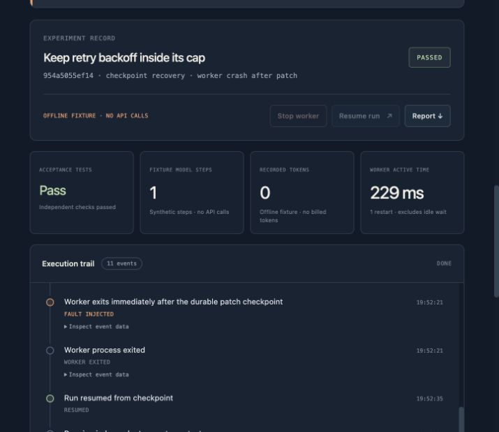

# Verification record — 2026-10-27 (America/Los_Angeles)

This records completed checks on the local MVP, including authenticated Nebius
inference, model-generated patches and Docker acceptance. It is not a general
model-quality benchmark, a production reliability claim, or proof that all
hackathon submission requirements have been met.

| Check | Observed result | Evidence |
|---|---|---|
| Default verification suite | 80 tests passed in the publication candidate | `python3 -m unittest discover -s tests -v` |
| Offline matrix | 18/18 configurations passed acceptance and selected-fault checks | [JSON](../examples/offline-check.json) |
| Recovery comparison | Crash profile: resume uses 1 fixture generation; restart uses 2. Both complete after a real worker exit 86. | Offline JSON, `metrics.fixture_calls` and events |
| Remote accounting in fixtures | 0 model requests, 0 recorded model tokens; fixture counters separate | Offline JSON |
| Docker acceptance | All 3 buggy starters fail; all 3 trusted repaired fixtures pass inside real Docker containers | [JSON](../examples/docker-check.json) |
| Manual kill during Docker execution | Owned container observed; worker killed; status crashed; 0 remaining run-labelled containers | Docker JSON, `manual_worker_kill_cleanup` |
| HTTP integration | 14 checks passed, including invalid requests, cross-origin rejection, crash/resume, and matching downloadable JSON | [JSON](../examples/http-check.json) |
| Browser | Created an experiment, observed interruption, resumed to passing tests; result survived server restart/reload | [Screenshot](assets/mvp-preview.png) |
| Credential exclusion | `.env`, run database, and Python caches are ignored by the local Git repository | `git check-ignore` |
| Live no-fault repair | Actual NVIDIA response; model-generated candidate passes all 4 Docker acceptance tests | [Live JSON](../examples/live-check.json), run `097c8237ac76423b` |
| Live worker crash and recovery | Real exit 86; same saved candidate resumes to 4 passing Docker tests with no additional model request or reported tokens | Live JSON, run `98b9aed5c9bc4f8e` |
| Public evidence viewer | Anonymous access, final/initial attempt switching, recorded-event navigation, source/report downloads | [Published website](https://agent-crashlab-evidence-jm.emiandtuzi.chatgpt.site) |
| Fresh release extraction | Sanitized tarball includes runtime, deployment recipe and web source; extracted fixture demo passes; no local .env | `scripts/package_release.py` plus fresh-directory smoke |
| HTTPS proxy template | Official Caddy image validates the template with test-only credentials, no networking/ports | [Proxy check](../examples/proxy-check.json); does not verify a remote VM deployment |

The Python suite covers provider request formatting using mocked HTTP responses,
independent task acceptance, process-exit recovery, restart counters, explicit
unknown usage, release-check conditions, source-domain restrictions, Docker
command constraints and cleanup. Mocked provider tests do not verify account
access, actual model availability, or real function-call output.

## Live Nebius verification

The account-visible and returned model ID is
`nvidia/nemotron-3-super-120b-a12b`. The task is `page-slices`: repair pagination
ranges and invalid-input handling, with independent tests the agent cannot edit.

The final [live report](../examples/live-check.json) has `complete=true` and
`passed=true`. Both cases use genuine model responses, zero fixture generations,
and zero requests with unknown usage.

| Final case | Actual model requests | Reported input tokens | Reported output tokens | Worker active time | Result |
|---|---:|---:|---:|---:|---|
| No fault | 1 | 626 | 283 | 2,649 ms | 4/4 Docker tests pass |
| Crash and one resume | 1 | 626 | 352 | 3,262 ms | 4/4 Docker tests pass |

In the recovery case, the worker committed its patch, exited with code 86, and
was observed in `crashed` / `validate`. Recovery preserved the candidate hash
`1686e50be9d1a9136d6e7c783629f7a79afc4e1f702889149ca565f829c3633c`.
The model request count remained 1; reported usage remained 626 input and 352
output tokens before and after the one resume. This proves reuse at this saved
patch boundary; it does not prove exactly-once inference for other crash windows.

### Preserved initial attempt and scope

The [initial live report](../examples/live-check-initial.json) is retained and has
`passed=false`. Both tasks eventually passed Docker acceptance, but the first
candidate used `slices.append`, which violated the existing pure-function
execution contract. After the worker recovered, validation rejected that
candidate and the agent generated a second valid one. The strict same-final-patch
and no-additional-inference checks correctly failed.

The execution-domain instructions were then made explicit in the user prompt;
the acceptance guard and tests were not weakened and no reference answer was
given to the model. The same two-case verification was run once more and passed.
This is prompt iteration on a small smoke task, not a held-out quality result.

Across both live attempts, there were **6 actual inference requests**, **3,606
reported input tokens**, and **1,697 reported output tokens**. The initial attempt
accounts for 4 requests / 2,354 input / 1,062 output; the final attempt accounts
for 2 requests / 1,252 input / 635 output. There are no unknown-usage requests in
either saved report. No dollar cost or statistical latency claim is inferred.

The Docker integration uses trusted fixtures and an explicitly pre-seeded
nonterminating candidate. The latter skips inference and verifies that killing a
test worker also removes its container. It is labelled
`docker_integration_without_model` and uses no genuine model credentials.

The offline matrix is 3 tasks × 2 recovery policies × 3 fault profiles, one run
per configuration. It is a plumbing smoke check; the saved results do not support
statistical latency, cost or generalization claims. `elapsed_ms` accumulates worker
active time and excludes idle recovery waiting.

The local machine runs Python 3.14.4 and Docker Engine 29.4.2. The Docker report
records the actual `python:3.12-slim` image content ID. Run reports include runtime,
task and candidate SHA-256 identities where applicable. No source commit has been
published yet.

## Remaining evidence before submission

- Expand beyond this one live repair task and preserve repeated fault comparisons
  if broader reliability or quality claims are made. Live restart-from-scratch
  comparisons and larger fault matrices are not yet measured.
- Publish the licensed source repository and a judge-accessible runnable demo/test build.
- Prepare the English submission and a public YouTube video shorter than three minutes.
- Freeze the submission version and preserve judge access through December 15.

The preview at `http://127.0.0.1:8765` now reads `.crashlab-live` and displays the
actual final Nebius repair/recovery history. To reproduce that view after stopping
another server on the same port, run `python3 -m crashlab --data .crashlab-live serve`.

